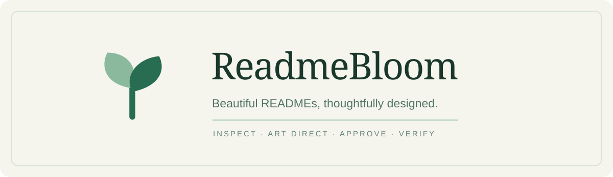

<p align="center">
  
</p>

# ReadmeBloom

<p align="center">
  A collaborative art director for GitHub READMEs. Built as a portable coding-agent skill.
</p>

<p align="center">
  <a href="LICENSE">MIT License</a> ·
  <a href="SKILL.md">Read the skill</a> ·
  <a href="https://readme-bloom.citrusmint12.chatgpt.site">ChatGPT plugin preview</a>
</p>

---

## The first impression is part of the product

A great README explains **what your project does**, makes people want to explore it, and helps them get started. ReadmeBloom treats writing, technical accuracy, composition and visual identity as one design problem.

It can **create a README from scratch**, **redesign an existing one**, or **audit** an existing README without changing it.

Its signature is a user-driven process, rather than a rigid template. **Visual direction is approved before any changes.**

| Discover | Art direct | Deliver |
| :--- | :--- | :--- |
| Inspect the actual repository, existing docs and assets. | Present 2–3 genuinely different directions and **wait for approval**. | Build a distinctive README and verify claims, commands, links and visuals. |

## Choose your starting point

| Starting point | ReadmeBloom's job | What stays non-negotiable |
| :-- | :-- | :-- |
| No README yet | Discover the project and draft an honest first impression. | No inferred features or made-up setup commands. |
| Existing README | Improve the opening, composition, navigation and evidence. | Preserve useful technical instructions and links. |
| Audit only | Identify visual, Markdown and documentation gaps. | No file edits without approval. |

## A short conversation before the design

ReadmeBloom asks focused questions about the things only you can choose:

- Who the README is for, and what someone should understand immediately.
- Whether it should feel minimal, editorial, product-first, technical, expressive or something else.
- Which screenshots, demos, diagrams and existing branding belong in it.
- Which sections should be prominent, and how much technical depth readers need.

It adapts those choices to the real project. **The agent must wait for your visual-direction approval before editing.**

## What the skill protects

**Art direction with judgment.** A distinctive opening, coherent hierarchy, balanced media and meaningful whitespace. No unnecessary badge walls, fake handmade textures or generic AI-generated visual clutter.

**Product communication.** A value proposition readers understand quickly; authentic visual demonstrations; a useful first action.

**Documentation integrity.** Existing useful technical details are retained; new features and commands are verified against source. Concept artwork is never passed off as a product screenshot.

## Installation

This repository is intended for coding agents that support the [Agent Skills](https://agentskills.io/) format or equivalent `SKILL.md` discovery.

1. Clone or download this repository.
2. Place its folder (including `SKILL.md`, `references/` and `scripts/`) in the skills directory supported by your agent. A common project-local location is `.agents/skills/readme-bloom/`.
3. Invoke it directly or ask the agent to improve a GitHub README.

The workflow is designed to be portable to Codex, Claude Code, OpenCode and other compatible agents. **Cross-agent runtime validation is pending**; no compatibility claim here implies it has already been tested on every harness.

Example request:

```text
Use ReadmeBloom to redesign this repository's README.
Inspect the actual project and existing documentation first.
Show me three distinct visual directions with previews,
then wait for me to approve one before modifying anything.
```

For quick installation in a repository, copying the entire `readme-bloom` directory under `.agents/skills/` is sufficient **when your agent supports that discovery path**. Consult your harness documentation otherwise.

## Included tools

The skill works through Markdown instructions alone. Two optional helpers use **only the Python standard library**:

### README audit

```bash
python3 scripts/readme_audit.py README.md
python3 scripts/readme_audit.py README.md --json
```

Checks local media/link targets, missing image alt text, placeholder patterns, badge density and Markdown hygiene. It does **not** verify the factual accuracy of project claims, external sites or GitHub-rendered appearance.

### Visual direction previews

```bash
python3 scripts/preview_concepts.py \
  --name "Example project" \
  --tagline "A verified value proposition" \
  --out-dir /tmp/readme-bloom-previews
```

Creates three **concept-only** SVGs (editorial, product-led and expressive). These demonstrate composition—not the appearance or capabilities of any actual application. A coding agent should tailor the directions to the project instead of blindly adopting these presets.

## Design references

ReadmeBloom draws general lessons from projects with strong visual presentation and communication:

- [Excalidraw](https://github.com/excalidraw/excalidraw): instant recognition and friendliness.
- [Gum](https://github.com/charmbracelet/gum): personality with clarity.
- [Catppuccin](https://github.com/catppuccin/catppuccin): consistent graphic language.
- [VHS](https://github.com/charmbracelet/vhs): demonstration plus usable docs.
- [n8n](https://github.com/n8n-io/n8n): product positioning and clear action paths.

These are inspiration, **not layouts or assets to copy**.

## Project structure

```text
readme-bloom/
├── SKILL.md
├── agents/openai.yaml
├── references/
│   ├── art-direction.md
│   └── interview.md
├── scripts/
│   ├── readme_audit.py
│   └── preview_concepts.py
├── assets/readme-bloom-hero.svg
├── tests/
├── LICENSE
└── README.md
```

## Contributing

Issues, examples and improvements are welcome. Good proposals should explain how they improve project communication, visual judgment, repository truthfulness or portability across agents.

## License

MIT © 2026 Lucio Bottacin. See [LICENSE](LICENSE).
